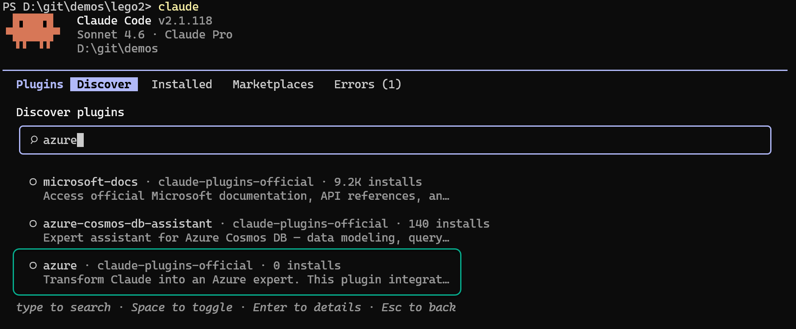

# GitHub Copilot for Azure

GitHub Copilot for Azure provides extensions and agent plugins to streamline developing for Azure. Use the extensions in Visual Studio and VS Code, or install plugins in supported clients such as VS Code, the GitHub Copilot app, Copilot CLI, and Claude Code. You can ask about Azure services or get help with Azure management and development.

[Learn more](https://aka.ms/LearnAboutGitHubCopilotForAzure) about GitHub Copilot for Azure, and get the extension:
- [VS Code](https://marketplace.visualstudio.com/items?itemName=ms-azuretools.vscode-azure-github-copilot)
- [Visual Studio 2022](https://marketplace.visualstudio.com/items?itemName=github-copilot-azure.GitHubCopilotForAzure2022)
- Visual Studio 2026 - included "in the box" as part of the "Azure & AI" workload

For agent plugins, see the client-specific installation paths below. [Claude Code](https://docs.anthropic.com/en/docs/agents-and-tools/claude-code/overview) uses a separate plugin marketplace.

## Usage

### Prerequisites

Use a client version that supports the chosen installation method and your organization's plugin policy. Review the plugin source and accept client trust prompts only when appropriate. Installation does not sign you in to Azure, grant permissions, or authorize resource changes. Azure sign-in, tenant/subscription access, and tools such as `az` or `azd` depend on the task and plugin; consult the package's requirements.

#### Git

Git is required for Git-backed marketplace operations such as adding the direct Microsoft marketplace. If it is not installed, you may see an error like:
`Failed to add marketplace: Failed to fetch GitHub marketplace microsoft/azure-skills: Error: spawn git ENOENT`

**Windows (winget):**
```powershell
winget install --id Git.Git -e --source winget
```

**macOS (Homebrew):**
```bash
brew install git
```

#### Node.js

Node.js is required when the selected plugin starts a local Azure MCP server using `npx` (including the base Azure plugin). It is not a universal prerequisite for every plugin or extension; for example, Azure Cost uses remote ARM MCP. If the local runtime is missing, you may see errors such as:
- Windows: `'npx' is not recognized as an internal or external command`
- macOS/Linux: `npx: command not found`
- Or the MCP server may fail silently with `npx failed to connect to azure`

**Windows (winget):**
```powershell
winget install --id OpenJS.NodeJS.LTS -e --source winget
```

**macOS (Homebrew):**
```bash
brew install node
```

### Installation

#### Native Copilot plugins: VS Code, Copilot app, and terminal CLI

For the base Azure plugin, open the [Azure catalog page](https://awesome-copilot.github.com/plugin/azure/) or use:

- [Install in VS Code](vscode://chat-plugin/install?source=github%2Fawesome-copilot&plugin=azure)
- [Install in GitHub Copilot app](ghapp://plugins/install?source=azure%40awesome-copilot)
- **Copilot CLI, from a terminal**:

  ```bash
  copilot plugin install azure@awesome-copilot
  ```

If deep links are unavailable or blocked by policy, use the HTTPS catalog page for the installation choices your client permits; do not bypass organization restrictions. Native VS Code plugins are distinct from the extension-managed skill copies described below.

All eight packages are listed in Awesome Copilot:

| Installable plugin name | Catalog |
| --- | --- |
| `azure` | [Azure](https://awesome-copilot.github.com/plugin/azure/) |
| `aks-skills` | [AKS Skills](https://awesome-copilot.github.com/plugin/aks-skills/) |
| `azure-advisor` | [Azure Advisor](https://awesome-copilot.github.com/plugin/azure-advisor/) |
| `azure-cost` | [Azure Cost](https://awesome-copilot.github.com/plugin/azure-cost/) |
| `azure-kusto-graph-skills` | [Azure Kusto Graph Skills](https://awesome-copilot.github.com/plugin/azure-kusto-graph-skills/) |
| `azure-local-skills` | [Azure Local Skills](https://awesome-copilot.github.com/plugin/azure-local-skills/) |
| `azure-observability` | [Azure Observability](https://awesome-copilot.github.com/plugin/azure-observability/) |
| `foundry-iq-skills` | [Foundry IQ Skills](https://awesome-copilot.github.com/plugin/foundry-iq-skills/) |

For another listed package, use its catalog page or substitute its installable name in `copilot plugin install <plugin-name>@awesome-copilot`. The base Azure source directory is `plugins/azure-skills`, but its installable name is `azure`. Each package has its own prerequisites and host limitations; a listing does not establish feature parity across clients.

Awesome Copilot references pinned published packages in `microsoft/azure-skills`; versions may differ from the direct Microsoft marketplace. Choose one source for each plugin. Avoid duplicate copies across marketplaces, local development plugins, and extension-managed global/workspace skills. Preserve intentional specialist dependencies rather than removing distinct required plugins.

After installing, confirm the plugin is enabled and loaded and that its skills are visible in the client's customization UI or skill listing, then start a fresh conversation. Follow that client's update controls; in interactive Copilot CLI, use `/plugin update <plugin-name>@awesome-copilot` for this source. Updates must retain the original marketplace suffix; installation does not promise automatic updates.

#### VS Code Azure extension: skill-copy alternative

The GitHub Copilot for Azure extension installs skills when the extension activates. At that point, you may see a toast notification like the following (if you don't see it, you can use the manual commands below):


To manually install skills from the Command Palette, the following commands are available:

- `@azure: Install Azure Skills Globally` — installs to your home directory (for example `~` on macOS/Linux or `%UserProfile%` on Windows), available in all workspaces
- `@azure: Install Azure Skills Locally` — installs to the current workspace folder, workspace-scoped
- `@azure: Uninstall Azure Skills Globally` — removes globally installed skills

#### Direct Microsoft marketplace: interactive Copilot CLI fallback

Enter these slash commands inside an interactive Copilot CLI session, not in a terminal shell:

1. Add the marketplace with `/plugin marketplace add microsoft/azure-skills`
2. Install the plugin with `/plugin install azure@azure-skills`
3. Update the plugin with `/plugin update azure@azure-skills`

For another package, substitute its installable manifest name for `azure`. Keep `@azure-skills` when updating a copy installed from this marketplace; it is not interchangeable with `@awesome-copilot`.

#### Claude Code

To install the Azure plugin into Claude Code, either:

- Run `/plugin install azure@claude-plugins-official`, or
- Run `/plugin` and search for "azure" in the marketplace



To update the plugin:

```
/plugin update azure@claude-plugins-official
```

## Sovereign Cloud Configuration

By default, the Azure MCP server connects to the Azure Public Cloud. If you use a sovereign cloud (Azure China Cloud or Azure US Government), you need to configure the MCP server to use the appropriate cloud environment.

### Copilot CLI

After installing the plugin from the marketplace, the skills are installed in `~/.copilot/installed-plugins/` on macOS/Linux (or `%USERPROFILE%\.copilot\installed-plugins\` on Windows). Edit the `<skill_installation_dir>/azure-skills/azure/.mcp.json` file in the installed plugin directory to add the `--cloud` argument:

> **Note:** Installed paths depend on the original marketplace; locate that copy's `.mcp.json` rather than assuming the direct Microsoft path above. For local development from the repository root, use `copilot --plugin-dir ./output/azure-skills` (PowerShell: `copilot --plugin-dir .\output\azure-skills`) and edit `output/azure-skills/.mcp.json` (`output\azure-skills\.mcp.json` on Windows), not the entire output root.

**Azure China Cloud:**

```json
{
  "mcpServers": {
    "azure": {
      "command": "npx",
      "args": ["-y", "@azure/mcp@latest", "server", "start", "--cloud", "AzureChinaCloud"]
    }
    // Keep the other MCP server configurations in this file as they are.
  }
}
```

**Azure US Government:**

```json
{
  "mcpServers": {
    "azure": {
      "command": "npx",
      "args": ["-y", "@azure/mcp@latest", "server", "start", "--cloud", "AzureUSGovernment"]
    }
    // Keep the other MCP server configurations in this file as they are.
  }
}
```

Before starting the MCP server, ensure your local CLI tools are authenticated against the correct cloud:

| Cloud | Azure CLI | Azure PowerShell | Azure Developer CLI |
|-------|-----------|-----------------|---------------------|
| China | `az cloud set --name AzureChinaCloud && az login` | `Connect-AzAccount -Environment AzureChinaCloud` | `azd config set cloud.name AzureChinaCloud && azd auth login` |
| US Government | `az cloud set --name AzureUSGovernment && az login` | `Connect-AzAccount -Environment AzureUSGovernment` | `azd config set cloud.name AzureUSGovernment && azd auth login` |

For more details, see [Connect to sovereign clouds](https://learn.microsoft.com/azure/developer/azure-mcp-server/how-to/connect-sovereign-clouds) in the Azure MCP Server documentation.

## Client Support Matrix

Built packages also conform to [Agent Plugins 1.0.0](https://agent-plugins.org/):
root `plugin.json` provides metadata, `mcp.json` provides portable MCP
configuration, and `skills/` provides skills. Copilot's namespaced hooks at
`com.github.copilot/hooks/hooks.json` are generated from `hooks/copilot-hooks.json`.
Existing client manifests, `.mcp.json`, and hook paths remain for backwards
compatibility. The matrix below describes existing client integrations;
format conformance does not imply every client supports the new layout.
Installation availability is not feature parity: plugin loading, MCP transports,
hooks, trust controls, and platform support depend on the client version and package.
Native VS Code and Copilot app catalog routes are available; their end-to-end
behavior is not asserted to match the CLI or extension.
See [plugin manifests](./docs/plugin-manifest.md) for details.

| Client | Skills | MCP Servers | Hooks | Marketplace | Manifest | Status |
|--------|:------:|:-----------:|:-----:|:-----------:|----------|--------|
| **Copilot CLI** | ✅ | ✅ | ✅ (`hooks/copilot-hooks.json`) | ✅ `.plugin/` | `.plugin/plugin.json` | ✅ Onboarded |
| **VS Code native plugins** | Host/package-dependent | Host/package-dependent | Host/package-dependent | Awesome Copilot / native install | Client-selected package manifest | Install route available; verify enabled features |
| **GitHub Copilot app** | Host/package-dependent | Host/package-dependent | Host/package-dependent | Awesome Copilot / app install | Client-selected package manifest | Install route available; verify enabled features |
| **Claude Code** | ✅ | ✅ | ✅ (`hooks/claude-hooks.json`) | `.claude-plugin/marketplace.json` (exists only in azure-skills repo)| ✅ `plugin/.claude-plugin/plugin.json` | ✅ Onboarded |
| **VS Code Extension** | ✅ (`.agents` folder) | ✅ | ✅ `hooks/copilot-hooks.json` (`.agents` folder) | Extension-based | Extension-based | ✅ Onboarded |
| **IntelliJ** | ✅ (`.agents` folder) | ✅ | ❌ Not supported by client | Extension-based | Extension-based | ✅ Skills Onboarded |
| **Gemini CLI** | ✅ | ✅ | ❌ Not supported by us | No marketplace | `gemini-extension.json` | ✅ Onboarded|
| **Cursor** | ✅ | ✅ | `plugin/hooks/cursor-hooks.json` |  `.cursor-plugin/marketplace.json` (exists only in azure-skills repo) |  ✅ `plugin/.cursor-plugin/plugin.json` | ✅ Onboarded. Hooks testing - WIP |
| **Codex** | ✅ | ✅ | ❌ Not yet supported by client (currently supports Bash-only) | [Claude-style marketplace](https://developers.openai.com/codex/plugins/build?install-scope=workspace#add-a-marketplace-from-the-cli) | ✅ `plugin/.claude-plugin/plugin.json` | ✅ Onboarded as local plugin (curated marketplace requires public MCP) |
| **Eclipse** | ❌ Not supported by client | ✅ | ❌ Not supported by client | Extension-based | Extension-based | ⚠️ MCP only |

## Contributing

You can use this repository to:

* Upvote a feature or request a new one.
* Search for potential work-arounds to problems you’re having.
* Provide feedback on using GitHub Copilot for Azure.
* Add features to our agent plugins. In each plugin README, label installation by client, use the manifest's installable name (not necessarily its source directory), and retain prerequisites, security and telemetry disclosures. Only advertise confirmed catalog listings; include an HTTPS fallback, the direct Microsoft marketplace route, and source-specific update guidance. Published README links must work independently of unmerged source changes.

See [CONTRIBUTING.md](./CONTRIBUTING.md) for detailed guidelines on how to contribute, including local development setup.
