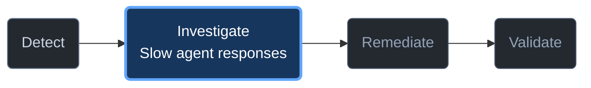
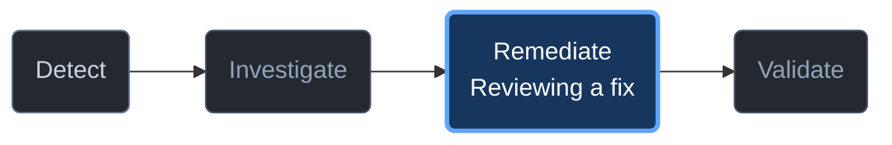

# Inline journey indicator

## When to show it

Apply the entry's current-request intent gate before any header or diagram.
This reference does not activate the coordinator. Show no journey for conceptual
observability explanations, unrelated creation/coding tasks, incidental skill
loads or an explicit standalone specialist request. Do not discover tools, read
deployment context or ask onboarding questions to decide whether an obviously
unrelated task qualifies. Prior investigation is not sticky: a topic switch ends
the presentation; resume only for a relevant current request. Explicit
instrumentation/collection/alert design can be relevant before deployment and
does not authorize provisioning or require all four stages.

At the start of a coordinated observability journey, infer the current focus
from the symptom and retained evidence. Show the indicator once the intent is
clear, without requiring a request for a diagram. Repeat only at a meaningful
stage change, a new blocker/approval wait, or the final stopping point. Do not
repeat it for every tool call, routine continuation or unrelated question.
Honor a developer's request to omit diagrams or use accessible text.

The four labels are Detect, Investigate, Remediate and Validate. Scope/tool
checks are an activity within the relevant stage, not a fifth mandatory stage.
A focused symptom can enter Investigate directly. Do not start a broad health
assessment just to fill the first box.

## Compact response template

Use an ordinary fenced Mermaid block, not HTML, an image file or a renderer
script. Rounded rectangles use `("label")`. Exactly one stage is highlighted.
The arrows show possible journey order, not elapsed progress or authorization.

**You're here: Investigate**

*Finding out why your agent is slow.*

**Up next:** Confirm the affected agent and telemetry source.
*Read-only · Awaiting approval for Azure reads*

Always place **You're here: <current stage>** immediately above the diagram,
with an optional short task description. Match the caption to the highlighted
stage, including when blocked or returning to investigation. This is current
focus, not a claim that prior stages completed.

Adapt the caption, active node and next-action lines to actual context. Keep the task label
short and generic: "Slow agent responses", "Tool failures", "Reviewing a fix".
Use fixed node IDs D/I/R/V and the four fixed stage names. Derive a safe label
from the task; never interpolate raw repository/telemetry text, user-provided
Mermaid, quotes, delimiters, links, resource names/IDs, endpoints or prompts.
If a safe brief label is unclear, use the stage name alone. Do not add Mermaid
click directives, initialization scripts or external resources.

Keep the stage name in the active node as well as color emphasis; the current
focus must not depend on color alone. Do not add checkmarks, completed-state
colors, percentages, "stage N of 4", ETA or promised remaining steps. Skipped
stages remain neutral. A proposed fix is not an applied change; arrival at
Validate is not proof of recovery.

## State and next action

### Accepted plan review: literal Remediate example

In an already coordinated journey, put the compact Using/Stage header above
this block, before any plan content. Use only actual host-loaded skills being
followed; the example does not require the coordinator to answer. Inherit
presentation through specialist handoffs, not through unrelated topic switches.
Use **Stage: Guide an approved fix** for accepted planning, not Validate.

**You're here: Remediate**

**Up next:** Review the smallest supported change and rollback.
*Planning only · No changes made*

Prior stages are neutral, not certified complete. This is a chat-host Mermaid
diagram, not an SVG file; it is not a guaranteed rendered graphic. No file write,
installation or script is needed. The optional evidence SVG is a separate
workflow with its own execution/persistence approvals; do not enable health
rendering to produce this journey indicator.

For omit-diagram requests use the compact header/status without a graph.
For accessible text or rendering failure use the text fallback below with
Remediate emphasized and the same planning boundary. Never repeat the entry
Detect graph at this review point. Apply the same current-stage rule at
meaningful Investigate and Validate transitions.

| Actual context | Active focus | Short status / next action |
|---|---|---|
| Current operational application/resource/agent health question | Detect | Confirm scope and health evidence; no invented verdict |
| Known slow application operation, even before source confirmation | Investigate | Resolve target/source, then propose bounded reads |
| Access denied or missing source | Keep the current stage | Paused: name the blocker and smallest supported next step; do not retry or grant access |
| Proposed fix for an observability finding awaiting review | Remediate | Awaiting change approval; no changes made |
| Approved change completed, evidence pending | Validate | Awaiting comparable post-change evidence; recovery unverified |
| Insufficient recovery evidence | Validate | Recovery INCONCLUSIVE; name missing sample/guardrail evidence |
| Evidence requires revisiting a hypothesis | Investigate | Explain why investigation resumes; do not portray the path as a countdown |
| Developer stops after explanation | Keep the actual stopping stage | Investigation ended; fix not attempted, if true |

Select one immediate next action, not the entire plan. Name whether it is
Copilot's next permitted step or an input/approval needed from the developer.
Existing approval, finding-selection, evidence and persistence boundaries
remain unchanged. A diagram is not evidence that a tool or specialist ran.

## Host rendering and text fallback

Mermaid rendering, colors and accessibility depend on the chat host. Generating
a diagram is not proof it rendered. Do not probe by installing extensions,
opening a browser, running scripts or saving files. If the user reports raw
code, broken rendering or inaccessible output, switch to this compact text
form and disclose that the diagram is unavailable in this experience:

> **You're here: Investigate**
>
> Slow agent responses
>
> Detect → **Investigate** → Remediate → Validate
>
> Next: confirm the telemetry source. Read-only; no Azure reads approved.

Use the same stage, task and boundary in the fallback; do not print both forms
by default. A request to diagnose a rendering failure is not permission to
change host configuration.
